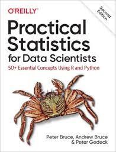

# Practical Statistics for Data Scientists

Kode Python yang mereproduksi konsep dan contoh dari buku **Practical Statistics for Data Scientists** karya Peter Bruce & Andrew Bruce (O'Reilly).

Repositori ini dibuat sebagai bagian dari **Tugas Mata Kuliah Machine Learning – Assignment 1**.

---

## Identitas Mahasiswa

| | |
|---|---|
| **Nama** | Muammar Yaldi Fadhil |
| **NIM** | 101032300019 |
| **Kelas** | TK-47-03 |
| **Mata Kuliah** | Machine Learning |

<a href="https://www.amazon.com/Practical-Statistics-Data-Scientists-Essential/dp/149207294X">

</a>

---

## Daftar Notebook

| # | Chapter | Topik Utama | Buka di Colab |
|---|---------|-------------|----------------|
| 1 | [Chapter 1 – Exploratory Data Analysis](./Chapter1_EDA.ipynb) | Mean, Median, Std Dev, IQR, Histogram, KDE, Korelasi, Scatterplot | [](https://colab.research.google.com/github/Lianaulya/Practical-Statistics-for-Data-Scientists/blob/main/Chapter1_EDA.ipynb) |
| 2 | [Chapter 2 – Sampling Distributions](./Chapter2_SamplingDistributions.ipynb) | CLT, Bootstrap, Confidence Interval, Normal/t/Binomial/Poisson Distribution | [](https://colab.research.google.com/github/Lianaulya/Practical-Statistics-for-Data-Scientists/blob/main/Chapter2_SamplingDistributions.ipynb) |
| 3 | [Chapter 3 – Statistical Experiments](./Chapter3_StatisticalExperiments.ipynb) | A/B Testing, p-value, Permutation Test, t-Test, ANOVA, Chi-Square, Power & Sample Size | [](https://colab.research.google.com/github/Lianaulya/Practical-Statistics-for-Data-Scientists/blob/main/Chapter3_StatisticalExperiments.ipynb) |
| 4 | [Chapter 4 – Regression and Prediction](./Chapter4_Regression.ipynb) | OLS, Multiple Regression, R², RMSE, Cross-Validation, Dummy Variables, VIF, Polynomial Regression | [](https://colab.research.google.com/github/Lianaulya/Practical-Statistics-for-Data-Scientists/blob/main/Chapter4_Regression.ipynb) |

---

## Cara Menjalankan

### Opsi 1: Google Colab (Direkomendasikan — Tanpa Instalasi)
Klik tombol **"Open in Colab"** pada tabel di atas. Pastikan untuk menjalankan sel instalasi paket di awal notebook.

### Opsi 2: Lokal
```bash
# Clone repository
git clone https://github.com/Lianaulya/Practical-Statistics-for-Data-Scientists.git
cd Practical-Statistics-for-Data-Scientists

# Install dependencies
pip install -r requirements.txt

# Jalankan Jupyter
jupyter notebook
```

---

## Requirements

```
matplotlib
pandas
scikit-learn
scipy
statsmodels
wquantiles
seaborn
pygam
dmba
pydotplus
imblearn
xgboost
prince
numpy
adjustText
```

> Data diambil langsung dari repository resmi buku: [gedeck/practical-statistics-for-data-scientists](https://github.com/gedeck/practical-statistics-for-data-scientists/tree/master/data)

---

## Ringkasan Materi

### Chapter 1 – Exploratory Data Analysis (EDA)
Teknik eksplorasi data untuk menemukan pola, anomali, dan hubungan antar variabel:
- **Estimasi Lokasi**: Mean, Trimmed Mean, Weighted Mean, Median
- **Estimasi Variabilitas**: Std Dev, Variance, MAD, IQR
- **Percentile & Boxplot**: Q1, Q2, Q3, whiskers
- **Histogram & Density Plot**: Distribusi kontinu
- **Korelasi**: Pearson r, heatmap korelasi

### Chapter 2 – Data and Sampling Distributions
Distribusi statistik dan prinsip sampling:
- **CLT**: Sampling distribution mendekati Normal seiring n bertambah
- **Bootstrap**: Estimasi distribusi tanpa asumsi parametrik
- **Confidence Interval**: 95% CI = x̄ ± 1.96·SE
- **Distribusi**: Normal, t-Student, Binomial, Poisson

### Chapter 3 – Statistical Experiments and Significance Testing
Desain eksperimen dan uji hipotesis:
- **A/B Testing**: Uji efektivitas perubahan produk
- **p-value & Hipotesis**: H₀, Hₐ, α = 0.05
- **Permutation Test**: Non-parametrik, berbasis resampling
- **ANOVA**: Uji beda rata-rata ≥ 3 kelompok
- **Chi-Square**: Uji independensi variabel kategorik
- **Power & Sample Size**: Menentukan ukuran sampel

### Chapter 4 – Regression and Prediction
Model prediksi linier dan evaluasinya:
- **Simple OLS**: ŷ = b₀ + b₁x (Ordinary Least Squares)
- **Multiple Regression**: ŷ = b₀ + b₁x₁ + ... + bₚxₚ
- **R² & RMSE**: Evaluasi kebaikan model
- **Cross-Validation**: Estimasi performa out-of-sample
- **Categorical Variables**: Dummy encoding
- **VIF**: Deteksi multikoliniearitas
- **Polynomial Regression**: Menangkap hubungan non-linier

---

## Referensi
- Bruce, Peter & Andrew Bruce. *Practical Statistics for Data Scientists* (2nd ed.). O'Reilly, 2020.
- Repository kode asli: [gedeck/practical-statistics-for-data-scientists](https://github.com/gedeck/practical-statistics-for-data-scientists)
- Referensi contoh: [farrelrassya/Practical-Statistics-for-Data-Scientist-Books](https://github.com/farrelrassya/Practical-Statistics-for-Data-Scientist-Books)
